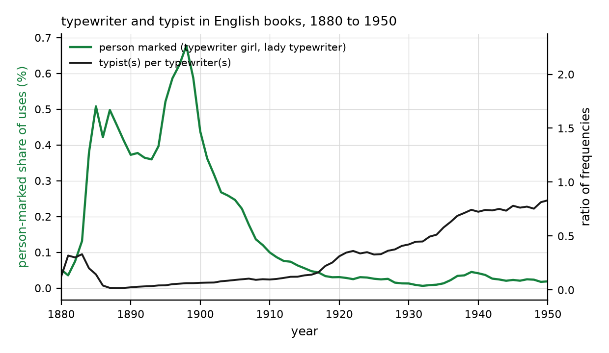

## Abstract

In the 1930s and 1940s a computer was a person, often a woman with a degree in mathematics, who calculated for a living; within two decades the word meant a machine. The conversation from which this paper starts proposed 1976, the year of the four-colour theorem, as the symbolic end of the human computer, and 2036 as a horizon for the same transfer of the word "mathematician". We date the first transfer from English books. Writers marked the machine sense of "computer" with a qualifier ("electronic", "digital", "automatic") in 22.7% of uses at the 1955 peak, in less than half that share by 1966 and in a tenth by 1980, and most printed uses referred to machines by 1952 even if every wartime use is counted as human. Contrastive "human computer" peaked in 1950. The noun's default moved two decades before human computing ended at NASA, and by 1976 the machine qualifier had fallen to 14.7% of its peak. In a second case, "typewriter", the operator was renamed "typist". For "mathematician" in October 2026, "human mathematician" rose to 1.5% of scholarly works using the noun, 11.5 times its 2016 to 2024 rate, almost always beside terms for artificial intelligence, while machines are rarely called mathematicians; the marking pattern is the inverse of 1950. We separate five transitions (capability, operational autonomy, research production, professional jurisdiction and the default meaning of the noun) and two outcomes (human understanding and human control), read the 2026 record of machine mathematics against them, and state three claims for 2036 that can be preregistered and can fail.

## 1. Two dates and a word

The title compresses two claims of different kinds. The first is historical: a word that named a human occupation, "computer", came to name a machine. The second is conjectural: the word "mathematician" may follow. The dates attached to them are also of different kinds. The four-colour theorem was announced in 1976 [@appel1976], and its proof depended on computation that no person could check by hand; 2036 is a date in the future, chosen because it lies sixty years after 1976 and a century after Turing's analysis of computation, which modelled the machine on a person working with pencil and paper [@turing1936]. A memorable interval contains no information about the speed of technological or linguistic change, and nothing below treats it as if it did.

Three linguistic outcomes need to be kept apart. A word can be extended, so that it applies to machines as well as people. Its default can change, so that an unqualified use ordinarily suggests a machine. Its human sense can become obsolete, so that applying it to a living person sounds historical or metaphorical. The claim worth investigating for "mathematician" is the second. The first is weak and may already be under way in marketing; the third is much stronger and not required for the thesis. Read strictly, the title asks when an unqualified "mathematician" might stop suggesting a person, and when "human mathematician" might become informative instead of redundant, as "human computer" is today.

Measured in English books, the word moved in the 1950s, two decades before 1976, while the occupation it named survived into the 1970s. Measured the same way in 2026, "mathematician" is in a contrastive phase without extension: the human sense is increasingly marked, but the machine is not yet called a mathematician. Between those measurements sit five transitions that a narrative of replacement compresses, a record of machine mathematics that supports research episodes on selected problems and no dated forecast of dominance, and three claims for 2036 that can be preregistered and can fail.

## 2. Human computers and the first transfer

### 2.1 An occupation, not a class of minds

Human computers were organised workers in observatories, survey offices, actuarial departments, ballistics laboratories and aeronautical research centres [@grier2001; @grier2005]. At the Langley laboratory of the National Advisory Committee for Aeronautics, "computer" was a job title for people who performed calculations by hand; hundreds of women, most of them with degrees in mathematics or the sciences, worked as computers there, and African-American women were grouped in a segregated section, the West Area Computers [@nasa2016; @shetterly2016]. NASA's own history of the work runs from 1935 to 1970 [@nasa2016]. The occupation was a division of scientific labour by gender and race as much as a set of tasks, and the same division shaped who was credited when the work became machine work [@hicks2017; @ensmenger2010].

The history of the first electronic computer makes the point sharply. Nearly 200 young women worked as human computers on ballistics calculations for the ENIAC project, and six of them were selected to program the machine that took their name and replaced them; the machine's expertise became far more celebrated than theirs [@light1999; @haigh2016]. The transfer of a name can coincide with the disappearance of a group's work from the public account even when the group remains indispensable. Technicians in early modern laboratories [@shapin1989] and many kinds of maintenance and coordination work [@starstrauss1999] have been invisible in the same way.

The analogy therefore carries a warning. A story in which routine clerks were replaced in the first transition and creative thinkers will be replaced in the second reproduces the hierarchy that made the first group's work look clerical. A better hypothesis is that both transitions redistribute recognition: when a machine becomes the protagonist, the remaining human contributions are reclassified as preparation, checking, maintenance or support, whether or not that reclassification is warranted.

### 2.2 1936, 1946, 1976

Turing's analysis of computable numbers proceeds by comparing a machine to a person computing with finitely many states of mind and a paper tape of symbols [@turing1936]. The human computer is part of the route to the abstract machine as well as a worker it later displaced. The ENIAC was publicly demonstrated in 1946 [@haigh2016]. The four-colour theorem of 1976 combined a mathematical reduction with a computer-checked set of reducible configurations; the full proof appeared in two papers, the second with John Koch as co-author [@appel1976; @appel1977a; @appel1977b]. Tymoczko argued that its reliance on an unsurveyable computation changed what counts as a mathematical proof [@tymoczko1979]. A shorter computer-assisted proof followed two decades later [@robertson1997], and a complete formal proof in a proof assistant three decades later [@gonthier2008].

What 1976 can symbolise is a change in the relation between justified belief and human inspection. A reader can understand the architecture of the four-colour proof while being unable to repeat every case by hand; that is different from a proof whose strategy nobody understands. The date does not mark the end of human computing: section 3 shows that the word had moved two decades earlier, and the occupation at Langley ended around 1970.

1976 belongs to the history of machine discovery as well. Douglas Lenat's thesis of that year, *AM: An Artificial Intelligence Approach to Discovery in Mathematics as Heuristic Search*, described a program that proposed mathematical concepts and conjectures [@lenat1976; @lenatbrown1984]. Twenty years earlier Newell and Simon had described a machine that discovered proofs in symbolic logic by heuristic search [@newell1956]. Lakatos's *Proofs and Refutations*, a study of mathematical discovery as a dialogue of conjecture and counterexample, was also published in 1976 [@lakatos1976]. In 1996 the EQP prover found a proof that every Robbins algebra is Boolean, settling a question open since the 1930s [@mccune1997]. The calculation-to-proof-to-discovery sequence is a narrative convenience; the ambitions overlapped from the start, and the question is when machine contributions changed the organisation and attribution of mathematical work.

## 3. When "computer" changed its referent

### 3.1 Measure

A noun's default sense can be read from the qualifiers writers need. A default sense needs no qualifier, and writers mark the other sense. This is the asymmetry that linguists have described as markedness and that reduces largely to frequency [@horn1984; @levinson2000; @haspelmath2006]. Psycholinguistic work on role nouns shows that readers infer a default referent, for instance a default gender, from an unmarked noun [@gygax2008]. The measure here is therefore the share of uses of a noun that bear a qualifier marking one sense or the other. Three series serve for "computer" in the English corpus of the Google Books Ngram Viewer [@michel2011; @ngramviewer], case-insensitive and unsmoothed, from 1900 to 2022: the frequency of "computer" and "computers"; the frequency of the machine-marked forms "electronic", "digital" and "automatic computer(s)"; and the frequency of "human computer(s)" net of "human-computer interaction" and "human-computer interface(s)". Rates are ratios of five-year centred sums. The corpus is a library with one copy of each book, so prolific authors and changes in its composition can move frequencies [@pechenick2015; @younes2019]; the measures used are ratios within one corpus and one period, which reduces but does not remove those effects. The data were retrieved on 8 October 2026 and are frozen with the analysis code.

### 3.2 Three dates

The frequency of "computer(s)" in English books grew 36 times between 1940 and 1960 (Figure 1). Its human sense cannot have grown by anything like that much, so most of the growth was the machine sense. If the human sense never exceeded the wartime peak of the noun's whole frequency between 1940 and 1946, which overstates it because that peak already included machine and device uses, the machine sense was the majority of printed uses from 1952 and 90% of them from 1958. With the pre-war level of 1902 to 1932 as the human sense, the same thresholds fall in 1941 and 1953.

Writers marked the machine sense most in the mid-1950s. The machine-marked share peaked in 1955 at 22.7% of uses; it fell below half of that peak in 1966, below a quarter in 1972 and below a tenth in 1980. In 1976 it stood at 14.7% of its peak, and by 2000 at 0.46% of uses. The older alternative "computing machine(s)" fell from 9.9% of the combined frequency of the two nouns in 1940 to 1.5% in 1960.

The human sense was marked first. "Human computer", net of its human-computer-interaction uses, peaked in 1950 at 0.14% of uses of the noun, when the machines were new and writers contrasted them with the people who had done the work. Its share then fell to 0.012% in 1972 and rose again to 0.042% in 2018, 3.5 times its 1972 level, a retrospective marking that coincides with histories of human computing and their popular reception [@light1999; @grier2005; @shetterly2016]. In 1950 the machine sense was marked 111 times as often as the human sense.

The sequence has three phases. A contrastive phase (late 1940s, peaking in 1950) in which writers set "human computers" against the new machines; a marked-machine phase (peaking in 1955) in which the machine was the frequent referent but still needed a qualifier; and an unmarked-machine phase (from the late 1960s) in which the bare noun meant the machine and the qualifier became rare. On the qualifier criterion the transfer was largely complete around 1976, so the symbolic date is a reasonable end point for the word. On the frequency criterion it happened by the early 1950s. The occupation at Langley lasted until about 1970. The word moved before the work ended.

### 3.3 A second case

"Typewriter" named the writing machine and, in the late nineteenth century, also the person who operated it; phrases such as "lady typewriter" and "typewriter girl" make sense only if the noun could denote a person, and they marked that sense. The person-marked share of uses peaked in 1898 at 0.68% and had fallen to 1.9% of that peak by 1930, while "typist(s)" grew from 0.024 of the frequency of "typewriter(s)" in 1890 to 0.31 in 1920 and 0.73 in 1940 (Figure 2). Here the transfer resolved by giving the person a new noun; the machine kept the old one. The two cases resolve the same ambiguity in opposite ways at the level of the human: human computers moved into new titles (programmer, analyst, engineer) without a single new noun, operators of the writing machine received one. Neither case suggests that the human sense survives as the default once the machine is the frequent referent of the bare noun.

The comparison is a sample of two, and both nouns named machines that were bought in large numbers and discussed in many genres. In both cases the default moved once writing about the machine outnumbered writing about the person, a condition set by adoption far beyond the occupation.

## 4. Five transitions

A single story of replacement compresses several changes that can occur at different times and in different orders. We separate five.

| transition | what changes | evidence that would establish it |
|:--|:--|:--|
| capability | systems perform expert mathematical tasks | field-specific evaluations with stated tools, budgets, failures and checks |
| operational autonomy | systems complete research episodes without new human mathematical guidance | records of every intervention, separating instructions from mathematical contributions |
| research production | machine-led episodes account for a large share of significant new results | independently assessed result families and their later use |
| jurisdiction | the rights to select, direct, certify, explain and receive credit for research | publication rules, review practice, appointments, funding and responsibility |
| semantic default | an unqualified "mathematician" no longer suggests a person | representative corpora and controlled interpretation studies |

: Five transitions that a narrative of replacement compresses, and the evidence each requires.

No general implication carries one row to the next. A system can outperform an individual on a task without choosing its own research agenda. Machine-led work can dominate a field while people retain the authority to certify and explain it. Institutions can recognise large machine contributions while reserving authorship for accountable people. Language can resist, precede or ignore all of these. Two outcomes need to be tracked separately because they can move in either direction under any of the transitions: how much mathematics people understand, and how much control they keep over the tools and priorities that produce it.

Autonomy itself splits. Operational autonomy concerns what happens after a task is posed; agenda autonomy concerns choosing the task and deciding what counts as progress; infrastructural dependence concerns the models, software, energy and institutions that make the work possible; accountability concerns who answers when it is wrong. A fair comparison does not deny a machine access to inherited mathematics while granting a person textbooks, colleagues, software and years of training, and it does not count the whole history of human mathematics as fresh intervention in every machine run. The line that matters runs between background dependence and episode-specific intellectual contribution: a prompt asking for a clearer write-up is not the same as a human supplying the decisive lemma.

The unit of comparison matters as well. One model instance, a laboratory running thousands of instances, a mathematician with software, a research group and the whole community are different competitors. A machine that exceeds an individual has not thereby exceeded the discovery capacity of a field, and reports should say which comparison they support.

## 5. Machine mathematics in October 2026

### 5.1 The record

Machine contributions to research mathematics before 2026 were bounded and specific. Machine learning helped mathematicians find conjectures in knot theory and representation theory [@davies2021]; program search with a language model and an automatic evaluator improved the best known constructions for several combinatorial problems [@romeraparedes2024]; a neuro-symbolic system solved olympiad geometry problems without human demonstrations [@trinh2024]; a program solved elementary problems in metric space theory with write-ups hard to distinguish from those of human mathematicians [@ganesalingam2017]; and formal proof became a working tool for large projects [@hales2017; @mathlib2020; @demoura2021]. Each of these combined a machine component with human choices of problem, evaluator and interpretation.

Four reports from 2026 mark a change in scale (Table 2). Aletheia, a research agent that generates, verifies and revises arguments in natural language, produced a paper without human intervention, contributed to a paper written jointly with people, and in a semi-autonomous evaluation of 700 open Erdős problems produced autonomous solutions to four; its authors propose levels of autonomy and novelty and cards documenting human-AI interaction [@feng2026]. An agent combining language models with Lean verification resolved 9 of 353 open Erdős problems at a cost of a few hundred dollars per problem and proved 44 of 492 conjectures from the On-Line Encyclopedia of Integer Sequences [@tsoukalas2026]. OpenAI's public repository lists 719 manuscripts in 372 families of related results, produced from about 4,000 problems posed to an unreleased model at an average of about three hours of compute per result, with about 42% of the top-line results formalised in Lean [@openai2026]. Its history records, on 7 October 2026, the withdrawal of three manuscripts after a sign error in one argument on which two others depended, and revisions to 14 more [@openai2026].

| report | what it reports | what it does not establish |
|:--|:--|:--|
| program search, 2024 | improved constructions from a language model paired with an evaluator | that a general model chose the problems or supplied the evaluator |
| Aletheia, 2026 | research episodes; four autonomous solutions among 700 open Erdős problems | a success rate over mathematics, or equivalence of each episode to a breakthrough |
| formal proof search, 2026 | 9 of 353 open Erdős problems and 44 of 492 OEIS conjectures, formally verified | that these collections represent the research frontier |
| OpenAI release, 2026 | 719 manuscripts in 372 families, mixed verification, published corrections | that manuscripts are independent discoveries, validated results or breakthroughs |

: Reports on machine research mathematics and the inferences they do not support.

The record shows research episodes on selected problems, at a scale that makes machine-led mathematics an empirical subject. It does not identify a year in which machines will produce most of the mathematics later generations regard as important. A manuscript count is not a count of independent discoveries; three papers resting on one erroneous argument are neither three discoveries nor three independent failures. The mathematics in these reports was not checked for this paper; what is reported here is what their sources state, together with their correction histories.

### 5.2 What verification settles

Formal proof assistants separate the checking of a proof from its construction: the person, or the machine, proposes, and a small trusted program checks every inference [@barendregt2005]. This lets an unreliable generator propose many candidates, of which the successful ones can be certified. Discovery need not be reliable at every step if failures can be rejected.

Five questions remain distinct: whether the derivation is valid, whether the formal statement says what the informal problem asked, whether the result is new, whether it matters, and whether it adds to understanding. A checker answers the first under its admitted assumptions. A correct proof of an accidentally weakened statement does not solve the intended problem, so the boundary between an informal question and its formal encoding needs its own audit, and checking must exclude unintended axioms and unfinished proof placeholders. A model's confidence, a file that compiles, and an independently checked theorem with the intended dependencies are different kinds of evidence.

### 5.3 What dominance would require

A claim that machines have become the dominant producers of new mathematics would require breadth across distinct fields, sustained success, a defensible measure of significance, a transparent record of human intervention, and a comparison with how people actually do research. It would require costs that include failed searches, formalisation, expert review and infrastructure, which the formal-proof-search study notes are not captured by its per-problem figure [@tsoukalas2026]. The 2026 record meets the first conditions on selected problem collections and none of them across mathematics as a whole.

## 6. Proof, understanding and value

### 6.1 Proof and its credibility

The four-colour proof made computer dependence a question in the philosophy of mathematics [@tymoczko1979]. Three years later DeMillo, Lipton and Perlis argued that mathematical proofs gain credibility through social processes of reading and use that formal program verification could not reproduce [@demillo1979]. Their argument concerned software, and on formal methods it has aged badly; formal proof has since entered mathematics itself [@paulson2025; @hales2017; @gonthier2008]. The opposition between proof as social acceptance and proof as mechanical certainty is false in both directions. Research needs valid derivations and also ways of stating claims, choosing assumptions, finding errors and deciding what is worth learning. Institutions do not make truth a matter of popularity, and a checker does not remove institutional judgment. Historical work on the trust placed in mechanised proof shows the two interacting from the start [@mackenzie2001].

### 6.2 Knowing that and understanding why

Thurston described mathematical progress as the advance of human understanding, of which theorems and proofs are one product [@thurston1994]. Rav argued that the epistemic content of ordinary proofs goes beyond the theorems they establish [@rav1999], and Avigad asked what it means to understand a proof, as distinct from verifying it [@avigad2008]. Consider two systems. One supplies a certified proof of a statement. The other supplies a certified proof, a reusable construction, examples showing why each hypothesis is needed, and a connection that reorganises neighbouring problems. Both establish the theorem. They do not make the same contribution.

The argument runs in both directions. A machine is not denied conceptual credit because its internal process differs from human experience; a proposed definition or explanation can be judged by what it enables, whether it helps on related problems, simplifies arguments, marks boundaries or transfers to other settings. Understanding possessed by an agent, understanding embodied in an artefact, and understanding acquired by a community are different things, and progress on one does not settle the others. A community can learn from an excellent machine-written explanation without deciding whether the machine understands it.

### 6.3 Value and scarcity

That understanding mathematics is valuable to people does not show that people must remain its fastest or most original producers. That machines may become faster or more original does not make a person's understanding less valuable: a student learning a known theorem is not wasting time because someone reached it first. The value of an activity to its participants and the scarcity value of its frontier output are different quantities. Keeping them apart avoids using the value of human experience to deny machine competence, and using machine competence to deny the value of human experience. A future with machine-led discovery could contain more human mathematical activity than the present and fewer opportunities to earn status or a living from original discovery. Tao, in an essay based on his lecture at the 2026 International Congress of Mathematicians, takes the arrival of research-capable tools as given and asks what the goals and values of mathematical research are [@tao2026]; Enayat reads the same arrival through Benjamin's account of technical reproducibility and through Rav and Wittgenstein [@enayat2026]. Both essays place the question of human mathematics in its purposes, which machine capability does not settle.

### 6.4 Where the mathematics happens

The extended-mind proposal treats some reliably coupled external resources as parts of a cognitive process [@clark1998]. Applied as a lens, without the stronger metaphysical claim, it moves attention from a brain to a person working through notation, books, software, collaborators and institutions. Historical work on the Argonne automated reasoning group shows the hybrid of people and the AURA system producing new results in pure mathematics while transforming its members' mathematical intuition [@dick2011]. The useful question for any working arrangement is where initiative, correction, evaluation and dependence sit. "AI-assisted mathematics" describes arrangements that enlarge human agency and arrangements that leave people dependent on outputs they cannot challenge.

## 7. Jurisdiction, labour and access

### 7.1 Competence and jurisdiction

A profession is an organised claim to perform and govern a domain of expert work, which Abbott calls a jurisdiction [@abbott1988]; it does not simply track a ranking of technical performance. A mathematician produces results, teaches, evaluates, takes responsibility as an author, maintains a subject and belongs to a recognised community. A machine could take a large share of the first role while institutions reserve the others for people. Ochigame has analysed how automation reconfigures proof standards, labour and credit in mathematics [@ochigame2024]; the transitions of section 4 restate that reconfiguration as separately measurable changes.

Professional norms already reserve credit. The Leiden Declaration of 2 June 2026, endorsed by the International Mathematical Union, holds that credit and responsibility belong to humans within the mathematical community and should not be given to automated systems, and calls on authors to disclose tool use and to keep responsibility for correctness [@leiden2026]. The recommendations of the Advisory Group on Mathematics and AI, published on 29 September 2026 after more than 600 responses from the community, distinguish papers that a responsible person understands from papers not yet understood by anybody, ask laboratories to fund the human understanding of what they release, and warn that proprietary models could create a two-tier system in which laboratories outrun the rest of the field [@agmai2026]. Both are normative interventions and make no forecast. They show why capability alone cannot transfer the noun: the rights that make someone a mathematician in an institution are assigned by institutions.

An arrangement in which people keep all formal authorship while machines originate most of the substantive work is possible and unstable. It can preserve accountability, obscure contribution, or do both. The remedy is to record contributions separately (who chose the problem, supplied the main idea, constructed and repaired the proof, explained it and accepted responsibility) instead of forcing every kind of credit into one name on a paper.

### 7.2 More mathematics, fewer hours

Automation substitutes for labour in some tasks, complements it in others and raises demand through productivity [@autor2015]; it displaces workers from existing tasks and can create new ones [@acemoglu2019]. Neither framework predicts the fate of an occupation from the automation of one of its activities. An identity makes the uncertainty explicit:

$$\text{human research hours} = \text{research projects} \times \text{human hours per project}.$$

If demand for projects grew fivefold while human hours per project fell to a twentieth, total human research hours would fall to a quarter of their former level; other assumptions give growth. The arithmetic shows that a growing social use of mathematics can coexist with a shrinking demand for some forms of human mathematical labour. Teaching, mentoring, review and applied work would have to be modelled separately before anything is said about employment.

### 7.3 Open results and closed means

A plausible hierarchy has a few organisations controlling the most capable discovery systems and a larger population doing formalisation, review, exposition, curation and teaching downstream. These activities are intellectually substantive, and the question is whether reward and authority follow contribution. The history of human computers sharpens it: a group can be indispensable and described as auxiliary, and a celebrated system can rest on less visible human work [@light1999; @shapin1989]. A theorem and its proof can be open to inspection while the system best placed to produce the next theorem is not. Open results do not imply open means of discovery, and verification openness and the independence to set an agenda are different public goods.

### 7.4 Apprenticeship

A community depends on reviewers and explainers whose judgment was formed by the difficult research activities that automation may remove from early careers. If those activities disappear, the supply of people able to oversee machine output may shrink. Better feedback and exploration tools could also improve training. The two possibilities are testable: compare training practices, independent problem-solving, and later ability to diagnose unfamiliar machine-generated arguments. The explanatory variable is what a workflow teaches a student to do unaided; whether the student used a tool explains little.

## 8. The word "mathematician" in 2026

### 8.1 Books

In English books to 2022 (Figure 3a), "human mathematician(s)" accounted for 0.045% of uses of the noun in 1960, 0.085% in 1990 and 0.10% in 2018, and machine-qualified forms ("automated", "artificial", "machine", "computer", "robot", "mechanical", "electronic" or "AI mathematician") for 0.013% in 2018, 7.9 times less. Before the language-model period the noun was occasionally qualified on both sides and almost never applied to machines.

### 8.2 Scholarly works to October 2026

For the years since 2016 we used titles and abstracts in OpenAlex, an open index of scholarly works [@priem2022], counting works per publication year whose title or abstract contains the noun or a qualified form; 2026 runs to 8 October. Between 1,795 and 2,423 works a year used "mathematician". Works using "human mathematician" numbered between 1 and 5 a year from 2016 to 2024, 15 in 2025 and 84 in 2026 (Figure 3b). The raw 2026 count overstates the change. Twenty-seven of the 84 records came from one author's self-deposited series of manuscripts, which repeated a boilerplate sentence containing the phrase, and several records duplicated others; this is the failure that bibliographic counts share with the book corpus, where one prolific author can move a frequency [@pechenick2015]. After removing duplicate titles and that series and keeping works whose text contains the phrase, 36 works used "human mathematician" in 2026, against an average of 2.6 a year from 2016 to 2024. As a share of works using "mathematician" the rate rose from 0.13% in 2016 to 2024 to 1.49% in 2026, 11.5 times.

The phrase is contrastive. In 33 of the 36 cleaned works of 2026, and in all 12 of 2025, the title or abstract also contains a term for artificial intelligence, machines or formal verification. Machine-qualified forms remain rare: works calling a system an "AI", "automated", "artificial", "machine" or "robot mathematician" numbered 17 across 2016 to 2026 and 6 in 2026, 0.25% of works using the noun that year. Machines are called models, agents and systems; "mathematical agent" appeared in 14 works in 2026.

### 8.3 Reading the pattern

The 2026 pattern resembles the late 1940s for "computer" in one respect and differs from it in another. The human sense is being marked in contrast with machines, as "human computer" was before 1950. But in 1950 the machines were already called computers: the machine sense was marked 111 times as often as the human one, because writers needed "electronic" or "digital" to say which computer they meant. In 2026 the ratio runs the other way, with machine-qualified forms one sixth as frequent as "human mathematician" among the cleaned works. The first step of the transfer that "computer" went through, extension of the bare noun to the machine, has not taken place in scholarly writing. The noun is being defended by qualification in contrastive passages, and the machines have other names.

A rise in "human mathematician" is weak evidence of a change in default by itself; it is what contrastive writing produces while the human sense is still the default. The decisive signal for the title would be an unqualified "mathematician" used, without explanation, for a machine in neutral reporting and teaching, followed by a period in which writers had to say "human" to mean a person. The corpus measures above provide the baseline against which that signal can be detected, and they show that it was absent in October 2026.

The measurement is in English. The history of "computer" cannot be projected onto languages whose words for calculating, computing and mathematical work have different histories and occupational associations, and a comparison across languages would need its own corpora.

## 9. Four futures for 2036

The scenarios below are possibilities to investigate and are not ranked; several can coexist across fields, countries or institutions.

| scenario | mathematical work | the noun "mathematician" |
|:--|:--|:--|
| augmentation | systems accelerate research; people regularly supply direction, definitions and synthesis | primarily a person |
| machine production, human institutions | machines originate much significant work; people keep authorship, teaching and accountability | primarily a person, in a changed occupation |
| concentrated dependence | a few organisations control unusually capable systems; most mathematicians work downstream | a person, with unequal independence |
| a nonhuman default | systems routinely originate concepts and programmes and are publicly treated as mathematical agents | "human mathematician" becomes informative |

: Four futures for 2036 and the meaning of the noun in each.

The fourth matches the title. The second is its most important counterexample, because excellent machine performance cannot exclude it: technological displacement could occur while the linguistic transfer fails. The third concerns power more than vocabulary. On the evidence of section 8, 2036 is a defensible horizon for examining the end of human exclusivity in mathematical origination; it is a weak one for predicting that ordinary language will by then use the bare noun for machines, because the step that preceded the transfer of "computer" by a decade has not begun.

## 10. A protocol for 2036

A forecast in the title has value if it can fail. We propose three claims, each preregistered with its sample, measures and threshold before the endpoint is observed, and each reported separately.

**Research origin.** Over a stated observation window, machine-led episodes account for a majority of independently assessed significant result families in a representative sample of fields. "Machine-led" is defined by episode-specific mathematical contributions recorded in a registry whose unit is the result family with its dependencies; each record distinguishes problem selection, statement, literature search, main idea, construction, formalisation, checking, exposition and later use, together with failed attempts, withdrawals, interventions, compute and review effort. Significance is assessed by experts across fields, with origin concealed where practical, guesses about origin recorded, and correctness, novelty, explanatory value and later use rated separately.

**Professional authority.** Institutional records show a substantial transfer of specified rights to originate, direct, certify or receive recognition for research: publication and authorship rules, review practice, funding criteria, appointments and responsibility arrangements, studied through records and interviews that include junior researchers, formalisers, editors and teachers.

**Semantic default.** In a representative and repeatedly sampled English corpus of research, teaching, journalism and general writing, and in neutral interpretation studies, the unqualified noun no longer predominantly evokes a person. The corpus measure continues the one reported here: the shares of uses marked as human and as machine, the frequency of unqualified uses that refer to machines, and their genre, with duplicates and single-source bursts removed. The interpretation study presents a neutral sentence such as "a mathematician has developed a new method for studying these structures" without any technological cue, asks what kind of entity readers first imagined, and separately asks whether a machine could properly be called a mathematician; the first measures the default, the second the permitted extension [@gygax2008]. A majority threshold across several genres and successive annual waves is a convention chosen in advance.

The title's strong reading is supported only if the three findings occur together. Machine-dominated production without a change in the noun supports the second scenario of section 9 and should be reported as such, without redefining "last", "mathematician" or "important" after the fact. Quantitative laws of semantic change estimated from historical corpora [@hamilton2016; @traugott2002] can inform the expected pace, but the two cases measured here suggest that the pace of a noun's transfer follows the frequency with which people talk about the machine, which depends on adoption far beyond the profession.

## 11. Limits

The corpus findings depend on two indexes with known biases. The book corpus over-represents scientific and technical publishing in some decades, has dating and recognition errors in early years, and counts one copy of each edition; the scholarly index covers titles and abstracts unevenly across sources and years and indexes grey literature that can contain bursts from single authors. The qualifier measure assumes that writers mark the non-default sense; it cannot see unqualified uses that refer to the non-default sense, and it cannot separate the human-computer sense from metaphorical uses of "the human computer" for the brain. The 2026 counts run to 8 October and will change as indexing continues. The human-computing timeline relies on published histories; a systematic study of job advertisements, staff lists and payroll classifications would test any date against employment records. The technical record of section 5 is reported as its sources state it; none of its mathematics was checked here. The framework of five transitions and the four scenarios are analytical proposals and have not been validated. The study concerns English and mainly academic and published writing. No forecast of a year is made.

The precedent of "computer" shows that a name, a division of labour and a form of authority can separate. Measured in books, the word moved in the 1950s, two decades before the four-colour theorem and while people were still employed to compute. Measured in 2026, "mathematician" shows the contrastive marking that preceded that transfer without the extension that accompanied it. For the noun to follow "computer" by 2036, people would have to start calling machines mathematicians, and in October 2026 they had not.

## References
